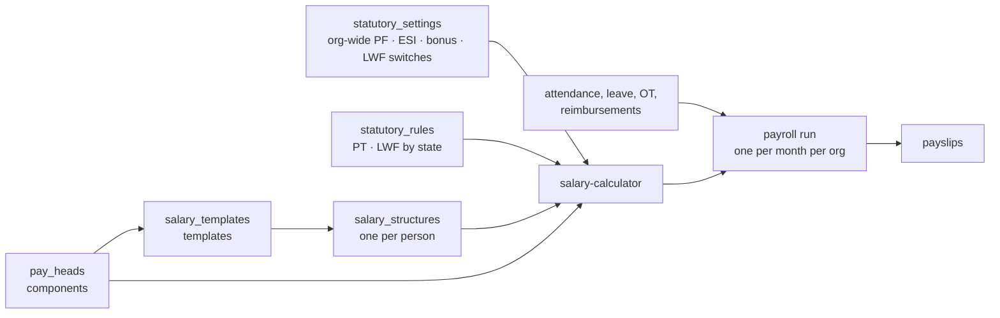

# Payroll architecture

How a salary is put together in Sowaka, from components to a monthly run.
The model is three layers plus one run:

| Layer | Plain name | Collection | Dashboard screen |
|---|---|---|---|
| Component | "ball" | `pay_heads` | Payroll › Salary Components |
| Statutory settings | same for everyone | `statutory_settings` (org-wide switches) + `statutory_rules` (per-state PT and LWF amounts) | Payroll › Statutory Components |
| Template | "basket" | `salary_templates` | Payroll › Salary Templates |
| Person's salary | basket assigned to one person, with their own changes | `salary_structures` | Employee profile › Salary, Add employee wizard |
| Run | one month, everyone at once | `payroll_runs`, `payslips` | Payroll › Payroll Runs |

All money is stored as integer paise.



## 1. Components ("balls")

A component is defined once per org in `pay_heads`. It owns:

- **Identity.** Name, name in payslip (the label every payslip prints; a template can give its own), code (org-unique, e.g. `BASIC`), category (earning, deduction, benefit, reimbursement) and earning type (`componentType`).
- **Treatment.** Part of salary structure, taxable, pro-rata, FBP, considered for EPF (always, or only while PF wage is under ₹25,000), considered for ESI, shown on payslip, active.
- **A default calculation.** Flat per month, a percentage of CTC, Basic or another component, or a per-person amount. Templates override the calculation; the treatment always comes from the component.

### Fixed settings per earning type

Some earning types pin settings. The form shows them ticked and locked, and the server applies the same values on create and update (`FIXED_EARNING_SETTINGS` in `backend/src/services/payHead.service.ts`). A client cannot store a Basic that skips PF.

| Earning type | Fixed on | Calculation allowed | Per org |
|---|---|---|---|
| Basic | Salary structure, taxable, pro-rata, EPF (always), ESI, payslip | Flat per month, or % of CTC | One |
| House Rent Allowance | Salary structure, taxable, payslip | Flat per month, or % of Basic | One |
| Food Coupon (meal card) | Salary structure, taxable, payslip. FBP option hidden on the form | Maximum amount per month | Many |
| Bonus (variable) | Taxable, payslip. Form only for now: Bonus is not wired to the API yet | Entered per person in the run | Many |

The remaining earning types keep every setting editable for now. Add a type to the table, the form's `SPECS[type].fixed` in `PayHeadMaster.tsx`, and `FIXED_EARNING_SETTINGS` together.

### Statutory components

Statutory items are never added to a template. One set of org-wide settings in `statutory_settings` (what Payroll › Statutory Components edits) applies to everyone, and the run works each item out per person from that month's pay and their work state:

| Item | Rule applied per person | Where |
|---|---|---|
| EPF | 12% each side on the PF wage, capped at ₹25,000 when the side is "restricted". Employer 12% splits into pension (8.33%, always capped) and PF. Optional: employer share, EDLI and admin charges inside CTC; employee-level override to actual wage; ceiling pro-rated for loss of pay; "under the ceiling" components tested after loss of pay | `statutory-engine.ts` `computeEpf`, `statutory-apply.ts` |
| ESI | 0.75% employee, 3.25% employer while gross ≤ ₹21,000. Once covered in a contribution period (Apr–Sep, Oct–Mar), covered until it ends even if pay rises | `esiCoveredThisPeriod` reads earlier payslips of the period; `applyStatutory` |
| Professional Tax | Slab on monthly gross, by work state | `statutory_rules` and the built-in defaults in `statutory.service.ts` |
| Labour Welfare Fund | Amount and cycle by work state; can be switched off per state | `statutory_rules`; `statutory_settings.lwfDisabledStates` |
| Statutory Bonus | When enabled and monthly: rate × max(Basic, state minimum wage for the person's category), for people with Basic ≤ ₹21,000; added as a payslip earning | `salary-calculator.ts` |

Work state comes from the person's `state`, or from their work city when no state is recorded (`workStateOf`). A person can be exempted from PF, ESI or LWF on their own salary (`salary_structures.statutory`), and may be switched to PF on actual wage when the org allows employee-level overrides.

Why statutory is not switched on or off per template: the law decides who PF, ESI, PT and LWF apply to by the person's wage and state, not by pay group. A template that dropped one would silently stop compliance for anyone moved onto it. Templates therefore list the statutory components read-only; exceptions are made per person, and switching an item off for everyone is done once in Statutory Components.

What a template may set is **which of its earnings make up the PF and ESI wage** (`salary_templates.statutoryWages`, the "PF and ESI wages" card on the template builder):

| Field | Absent (default) | Set |
|---|---|---|
| `pfComponents` | each component's own "Consider for EPF" | the listed earnings count (Basic included or not); a listed component marked "only under the ceiling" keeps that condition |
| `pfWageMode` | the org's restricted / actual setting (and a person's override) | `ceiling`: 12% capped at the ceiling; `actual`: 12% of the whole PF wage. EPS stays capped either way |
| `esiComponents` | ESI on gross pay | ESI eligibility (≤ ₹21,000) and contribution on the listed earnings (+ overtime) |

All three absent reproduces payroll exactly as before. Checked by recomputing every ACMT structure (53, three months, with and without loss of pay: 318 structure + payslip computations) with the calculator before and after the change: no field differs. Convrse's 4 structures: no field differs.

## 2. Templates ("baskets")

`salary_templates` hold an ordered list of `{ payHeadCode, calculation }`, plus:

- a balancing component, usually Special Allowance, which takes whatever CTC is left, after any employer PF or ESI share the org places inside CTC;
- a paid-days switch (`paidDaysEnabled`): when on, the run reads each person's attendance calendar and applies the template's deduction rules (late, early, absent and others turned into loss-of-pay days) and the paid leave days a month; when off, every working day is paid for everyone on the template.

At calculation time `resolveTemplateComponents` merges each template line with its component: identity and treatment from `pay_heads`, calculation from the template. Changing a component's treatment therefore reaches every template that uses it, while each template keeps its own percentages.

Template validation mirrors the component form. Basic is a flat monthly amount or a % of CTC, and HRA is a flat monthly amount or a % of Basic. A template with any "% of Basic" line must contain Basic, and percentage references may not form a cycle.

## 3. A person's salary

`salary_structures` holds one document per person:

| Field | Meaning |
|---|---|
| `salaryTemplateCode` | The basket |
| `annualCtcPaise` | Their CTC |
| `componentValues` | Per-person amounts by component code, for "per-person amount" lines and overrides |
| `statutory` | Their EPF, ESI and LWF switches |
| `status` | `draft` or `active`; only active people are paid |

### Add, remove or edit a ball for one person

A person's salary is their template plus their own changes, kept in `salary_structures.overrides`:

```ts
overrides?: {
  add?: { payHeadCode: string; calculation: CalculationBasis }[]; // balls only this person has
  remove?: string[];                                              // basket balls this person doesn't get
  edit?: Record<string, CalculationBasis>;                        // a different rule for one ball
}
```

Resolution (`applyOverrides` in `salaryTemplate.service.ts`, used by the structure service and the payroll run):

1. Start from the template's components.
2. Drop `remove`, replace `edit`, append `add`.
3. Resolve against `pay_heads`, as `resolveTemplateComponents` does.
4. Check for calculation loops, then run the calculator with CTC and the statutory switches.

Rules:

- Basic cannot be removed for one person.
- Fixed settings still come from the component, never from the override.
- Changing a person's template clears their overrides (the Salary Revision page does this).
- Every override calculation is validated the way a template's is.

Every CTC change is appended to `salary_structures.revisions` (previous CTC, new CTC, effective date) for the Salary Revision History.

On the dashboard, the employee's **Salary details** tab shows the whole assigned template with Monthly and Annual amounts, Cost to Company, the person's PF, ESI and LWF switches, and the revision history. **Revise** opens a standalone Salary Revision page: pick the template, revise the CTC by a percentage or a new amount, set the effective date, then add, remove or edit components for this person only. The template itself never changes.

### What CTC holds (matches Zoho)

Monthly CTC = earnings + reimbursements + employer benefits (gratuity) + any employer PF / ESI share the org keeps inside CTC. The balancing component takes what is left. Verified against Zoho's September 2026 run for two Convrse employees on different templates (₹30 lakh and ₹7.92 lakh CTC): all 26 lines match to the paisa for both.

- **Reimbursements** in a structure are paid in full every month at their amount (template flat amount, a per-person value, or the component's monthly limit). They sit inside CTC and net pay, outside gross pay. Approved expense claims come on top.
- **Meal Card** is paid as an earning and taken back as **Food Coupon Deduction**, because it is loaded onto a card.
- **Statutory Bonus** as a template component pays its percent of Basic or the state minimum wage, whichever is higher, only while Basic is ₹21,000 or less.
- **PF ceiling is dated** (`EPF_CEILING_SCHEDULE` in `statutoryRule.model.ts`): ₹15,000 until 16 September 2026, ₹25,000 from 17 September. A month that straddles a change uses the day-weighted average, so September 2026 is ₹19,666.67, which is what Zoho applied to every Convrse employee. A person can still have their own restricted PF wage (`salary_structures.statutory.pfRestrictedWagePaise`). EDLI rounds to the rupee, admin charges to the paisa.
- **Income tax** is entered per person on the run (`incomeTaxPaise`) until a TDS engine exists.

## 4. One payroll run for everyone

`createRun(period)` builds one run per org per month:

1. Load every `active` salary structure, the component catalog and all templates.
2. For each person, resolve the structure, then compute gross, statutory and deductions.
3. Apply the month: loss-of-pay days from attendance and the template's deduction rules, approved leave, approved overtime and approved reimbursements.
4. Write one payslip per person and the run totals.

Run states: `draft`, `pending_approval`, `approved` or `rejected`, then `paid`. A draft can be recomputed with per-person loss-of-pay and overtime changes. A rejected run can be recreated for the same month.

## 5. What is live today

| Piece | State |
|---|---|
| Salary Components › Earnings › Basic, House Rent Allowance, Food Coupon | Live: list, add, edit and delete through `/admin/payroll/pay-heads`, with fixed settings enforced on both ends. Delete is refused while a template uses the component |
| Salary Components › Deductions | Live: the four standard deductions save to `pay_heads` on first save |
| Salary Components › every other earning, benefit and reimbursement | Live: Special, Fixed, Conveyance, LTA, Medical, Telephone, Children Education, Statutory Bonus, custom allowances and one-time Bonus; employer benefits (Gratuity, employer NPS, other); reimbursements with their monthly limit. A component's code never changes once created; delete is refused while a template or a person's salary uses it |
| Payslip names and visibility | Live: a line prints under the template component's payslip name, else the component's, else its name. A component with "Show in payslip" off (on the component or the template) is not listed on the server slip, the dashboard slip or the app, but stays in every total |
| Salary Templates | Live. "Create New" and "Edit" open a standalone builder page laid out like Zoho's: "Build your Template" on the left lists the active components by group (click to add), the form on the right has name, description, Annual CTC (preview only), the grouped component table with live amounts and Cost to Company, the read-only statutory list and the paid-days rules with their on/off switch. The detail page lists the components with Monthly and Annual columns. The template code is generated from the name; the per-template EPF ceiling switch is gone (org-level now) |
| Statutory Components | Live through `/admin/payroll/statutory-settings`; PT and LWF cards come from the roster's work states; every save changes the next payroll run |
| Salary structures, runs, payslips | Live |
| Per-person add, remove or edit of a ball | Live: `salary_structures.overrides`, edited on the employee's Salary details tab |

## 6. Next steps

1. Feed `taxable` into the TDS projection when tax is added to runs.

## Watch-outs

- **ACMT's Basic is stored with EPF and ESI off.** Opening and saving it will turn both on, because they are fixed for Basic. All 52 of ACMT's active salary structures have PF and ESI switched off per person, so their pay does not change. The one structure without switches is a draft for "Demo Admin", and runs skip drafts.
- **Templates that had the EPF ceiling switched off** (Convrse's "Contract / Consultant") no longer cap PF per template. The org-wide setting applies; a person who should contribute on actual wage gets the employee-level override once "Override PF contribution rate at employee level" is on.
- **Missing work states** now fall back to the work city, so Convrse's Gurgaon, Noida and Kolkata people and ACMT's Delhi people resolve a state even where none is stored.
- **Convrse's existing Basic and HRA** already match the fixed settings, apart from fields that were never stored (payslip name, taxable, structure, payslip). Those fill in on their next save, and the form shows them ticked meanwhile.
